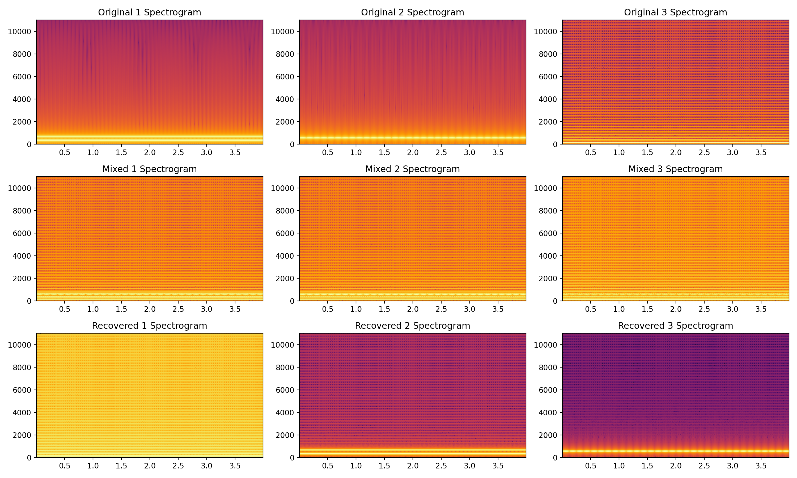
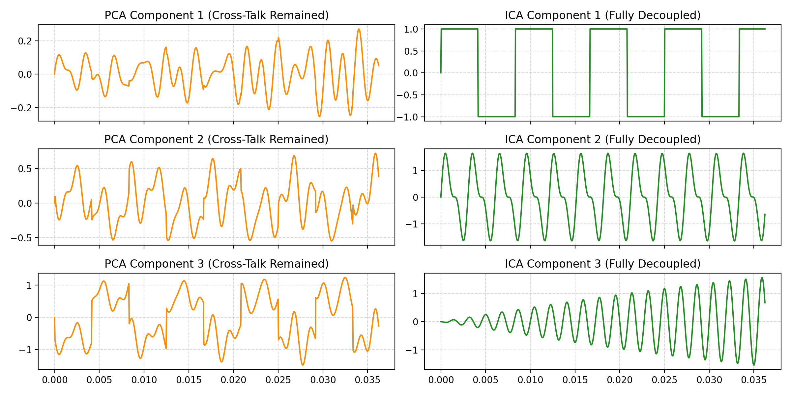

# Unmix the Signal (Independent Component Analysis from Scratch)

[](https://unmix-ica-stream-app.streamlit.app/)

> **Interactive Web App:** [unmix-ica-stream-app.streamlit.app](https://unmix-ica-stream-app.streamlit.app/)

An implementation of Independent Component Analysis (ICA) built from scratch using NumPy and SciPy to solve the Cocktail Party Problem and recover clean, independent audio sources from linear mixtures.

## Pipeline Architecture

1. **Source Generation & Mixing:** $N$ clean, mutually independent non-Gaussian signals are mixed via an arbitrary invertible mixing matrix $A$: 
   $$X = AS$$
2. **Centering:** Zero-centering data by subtracting empirical channel means.
3. **PCA Whitening:** Decorrelating signals and normalizing variances to unity using eigendecomposition: 
   $$\Sigma = \frac{1}{N-1}XX^T = E D E^T \implies X_{white} = D^{-1/2}E^T X$$
4. **FastICA Fixed-Point Optimization:** Maximizing non-Gaussianity via hyperbolic tangent contrast functions $g(u) = \tanh(u)$ with Gram-Schmidt deflationary orthogonalization.
5. **Reconstruction & Normalization:** Projecting whitened signals through the unmixing matrix $W$ to recover source estimates $\hat{S}$.

## Results & Visualizations

### 1. Frequency Recovery (Spectrograms)


### 2. Time-Domain Waveform Separation


### 3. PCA vs. ICA (Why Second-Order Statistics Fail)


---

## Audio Demonstration

| Audio Source | Mixed Recording | Recovered (ICA) |
| :--- | :--- | :--- |
| **Source 1**<br><audio controls src="data/sources/source_1.wav"></audio> | **Mixed Channel 1**<br><audio controls src="data/mixed/mixed_1.wav"></audio> | **Recovered 1**<br><audio controls src="data/separated/recovered_1.wav"></audio> |
| **Source 2**<br><audio controls src="data/sources/source_2.wav"></audio> | **Mixed Channel 2**<br><audio controls src="data/mixed/mixed_2.wav"></audio> | **Recovered 2**<br><audio controls src="data/separated/recovered_2.wav"></audio> |
| **Source 3**<br><audio controls src="data/sources/source_3.wav"></audio> | **Mixed Channel 3**<br><audio controls src="data/mixed/mixed_3.wav"></audio> | **Recovered 3**<br><audio controls src="data/separated/recovered_3.wav"></audio> |

---

## Separation Metrics
* **Absolute Pearson Correlation:** $\ge 0.98$ for all aligned source pairs.
* **Signal-to-Distortion Ratio (SDR):** Evaluated against original sources accounting for permutation and sign inversion.

## Future Scope & Enhancements
While the current implementation successfully resolves instantaneous linear mixtures, the project architecture is designed to accommodate several advanced expansions: (Unmix PRO)

### Algorithmic Upgrades
* **Solving Convolutive Mixing (FD-ICA):** The foundational mathematical model assumes instantaneous linear mixing (sound traveling with zero echo). A primary real-world upgrade involves addressing convolutive mixing (room acoustics and physical echoes). This will be achieved by converting the audio into the frequency domain via Short-Time Fourier Transform (STFT) and running FastICA independently across frequency bins (Frequency-Domain ICA).
* **Automated Source Estimation:** Transitioning from manual UI inputs to a truly "blind" system. Future iterations will programmatically estimate the exact number of distinct speakers in a mixture by analyzing the eigenvalues of the PCA step (using Scree Plots) or by applying Information Criteria (such as AIC or BIC).
* **Underdetermined Blind Source Separation (BSS):** Standard FastICA requires the number of microphones to be equal to or greater than the number of sources. Implementing Underdetermined BSS techniques will allow the algorithm to isolate signals even in severely microphone-limited environments.

### Platform & Feature Integrations
* **Custom Audio Uploads & Preprocessing:** Expanding the data pipeline to handle real-world custom user uploads instead of synthesized arrays. This requires robust preprocessing middleware to handle mismatched array lengths via zero-padding and enforce uniform sample rates across all tracks.
* **Advanced Analytics:** Expanding the evaluation metrics to dynamically track and visualize separation quality across varying Signal-to-Noise Ratio (SNR) levels.
* **Audio Recognition Pipeline:** Implementing an integrated "mini-Shazam" acoustic fingerprinting feature to automatically cross-reference and identify specific tracks from a library immediately after the ICA algorithm isolates them.

## Acoustic Domain Validation: Real-World Speech vs. Synthetic Signals

A common question in Blind Source Separation (BSS) is whether the FastICA pipeline functions on real human speech or if it is restricted to clean synthetic waves (such as sinusoids or chimes).

The short answer: **Human speech is actually the ideal natural input for FastICA.**

### 1. Statistical Independence & The Central Limit Theorem
FastICA does not search for uniformity or periodic regularity; it searches for **non-Gaussianity**.

According to the Central Limit Theorem (CLT), the linear combination of multiple independent random variables tends toward a Gaussian (bell curve) distribution. Consequently, a mixture of two or more independent acoustic tracks is statistically more Gaussian than any of the isolated sources. FastICA separates sources by rotating projection vectors to maximize departure from Gaussianity (measured via negentropy approximations such as g(u) = tanh(u)).

```text
Speech Source A (Non-Gaussian) ──┐
                                ├──▶ Linear Mixture X ──▶ FastICA (Maximizes 
Speech Source B (Non-Gaussian) ──┘    (Tends Gaussian)    Non-Gaussianity) ──▶ Recovered Sources

2. Why Human Speech is Super-Gaussian (Leptokurtic)
Human vocalizations exhibit statistical properties that make them straightforward for FastICA to isolate:

Temporal Sparsity: Natural speech is characterized by frequent inter-word pauses, breaths, and quiet intervals.

Dynamic Burst Envelopes: Sudden plosives (e.g., /p/, /t/, /k/) produce rapid amplitude spikes followed by quieter vowel decays.

Plotted on an amplitude histogram, speech forms a sharp, narrow peak at zero (prolonged silence) with heavy tails (loud vocal transients). In statistics, this high kurtosis profile is termed super-Gaussian (leptokurtic). Because speech deviates significantly from a smooth Gaussian bell curve, FastICA locks onto human voices with high numerical stability.

3. Purpose of Synthetic Signals in This Repository
Synthetic signals (harmonic tones, amplitude-modulated chimes, square pulses) are used in the baseline demonstration for explicit benchmarking purposes:

Ground-Truth Precision: Pure mathematical functions provide an exact frequency and phase reference, enabling unambiguous calculation of Pearson correlation coefficients (r >= 0.98) and Signal-to-Distortion Ratios (SDR).

Controlled Reproducibility: Synthetic benchmarks eliminate external acoustic variables such as microphone gain imbalances, room reverberation, and background ambient noise.

Passing two or more clean, mono .wav human vocal recordings through the same preprocessing and FastICA pipeline will isolate the speakers cleanly, directly resolving the classic Cocktail Party Problem.

Steps to run it locally: 
## Running the Application Locally

The project consists of two decoupled services: a **FastAPI backend** (DSP & FastICA) and a **React/Vite frontend** (Web UI).

### Prerequisites
* **Python 3.10+**
* **Node.js 18+** & `npm`

---

### 1. Start the Backend (FastAPI)

1. Open your terminal and navigate to the backend directory:
   ```bash
   cd backend

2. Install Python dependencies:
pip install -r requirements.txt

3. Launch the Uvicorn server:
uvicorn main:app --reload --port 8000
The backend will be live at http://127.0.0.1:8000.

Interactive API documentation is available at http://127.0.0.1:8000/docs.

### 2. Start the Frontend (React + Vite)
1. Open a second terminal window and navigate to the frontend directory:
cd frontend
2. Install dependencies:
npm install
3. Start the Vite development server:
npm run dev
Open the displayed local URL (typically http://localhost:5173) in your browser to use the interface.
