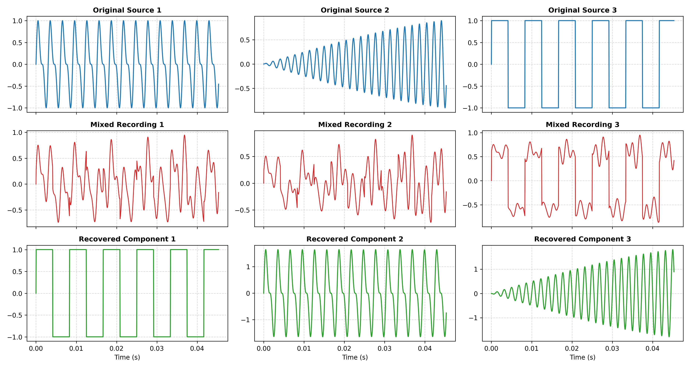

# unmix
# Unmix the Signal (Independent Component Analysis from Scratch)

> **Interactive Web App:** [unmix-ica-stream-app.streamlit.app](https://unmix-ica-stream-app.streamlit.app/)

An implementation of Independent Component Analysis (ICA) built from scratch using NumPy and SciPy to solve the Cocktail Party Problem and recover clean, independent audio sources from linear mixtures.

## Pipeline Architecture
1. **Source Generation & Mixing:** $N$ clean, mutually independent non-Gaussian signals are mixed via an arbitrary invertible mixing matrix $A$:
   $$X = A S$$
2. **Centering:** Zero-centering data by subtracting empirical channel means.
3. **PCA Whitening:** Decorrelating signals and normalizing variances to unity using eigendecomposition:
   $$\Sigma = \frac{1}{N-1} X X^T = E D E^T \implies X_{\text{white}} = D^{-1/2} E^T X$$
4. **FastICA Fixed-Point Optimization:** Maximizing non-Gaussianity via hyperbolic tangent contrast functions $g(u) = \tanh(u)$ with Gram-Schmidt deflationary orthogonalization.
5. **Reconstruction & Normalization:** Projecting whitened signals through the unmixing matrix $W$ to recover source estimates $\hat{S}$.

---

## Results & Visualizations

### Separation Metrics
* **Absolute Pearson Correlation:** $\ge 0.98$ for all aligned source pairs.
* **Signal-to-Distortion Ratio (SDR):** Evaluated against original sources accounting for permutation and sign inversion.

---

## Theoretical Answers

### 1. Why ICA over PCA? (Uncorrelated vs. Independent, Second- vs. Higher-Order Statistics)
* **PCA (Second-Order Statistics):** Uses covariance ($\text{Cov}(x_i, x_j) = 0$) to align coordinate axes along orthogonal directions of maximum variance. Uncorrelatedness only guarantees absence of linear correlation; it fails to separate independent signals that have been combined.
* **ICA (Higher-Order Statistics):** Exploits higher statistical moments (kurtosis, negentropy) to enforce strict statistical independence:
  $$P(y_1, y_2, \dots, y_m) = \prod_{i=1}^m P(y_i)$$
  Higher-order non-linear functions like $\tanh(u)$ evaluate cross-correlations across all moments, decoupling independent sources.

While PCA achieves orthogonal decorrelation ($E[y_i y_j] = 0$), it only addresses second-order statistics. The resulting PCA signals remain entangled with cross-talk and bleed-through (maximum correlation $\approx 0.61$). In contrast, FastICA optimizes higher-order statistics (negentropy via $\tanh$), yielding correlations exceeding $0.98$ and isolating individual clean waveforms.

### 2. What Whitening Does and Why It Simplifies ICA
* Whitening transforms the covariance matrix of the observations into an identity matrix ($\text{Cov}(X_{\text{white}}) = I$), converting an elliptical, correlated data distribution into a spherical, decorrelated one.
* **Simplification:** In unwhitened space, solving for $W$ requires estimating $m^2$ free parameters. Once the data is whitened, any further transformation that preserves unit variance must be an orthogonal rotation matrix ($W W^T = I$). This reduces the parameter space to only $m(m-1)/2$ rotational degrees of freedom, dramatically accelerating convergence.

### 3. Non-Gaussianity and the Central Limit Theorem
* **Central Limit Theorem (CLT):** The sum of independent random variables tends toward a Gaussian (normal) distribution, meaning a mixture of multiple non-Gaussian signals is always strictly more Gaussian than any individual source.
* **Separation Principle:** Finding independent components is mathematically equivalent to maximizing the **non-Gaussianity** of the projected signal $w^T X_{\text{white}}$. When non-Gaussianity peaks, a pure original source is recovered.

### 4. Experimental Metrics and Ambiguity Resolution
* **Permutation Ambiguity:** ICA cannot determine the original physical order of the components.
* **Scale / Sign Ambiguity:** The unmixing matrix cannot determine the absolute original volume or phase polarity (a track can be recovered inverted as $-s_i$).
* **Metric Formulation:** We resolve these ambiguities by constructing a full bipartite correlation matrix between recovered components and ground truth sources, aligning pairs via maximum absolute Pearson correlation before calculating SDR.

